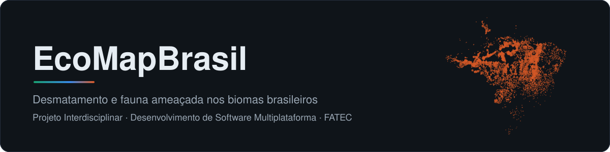
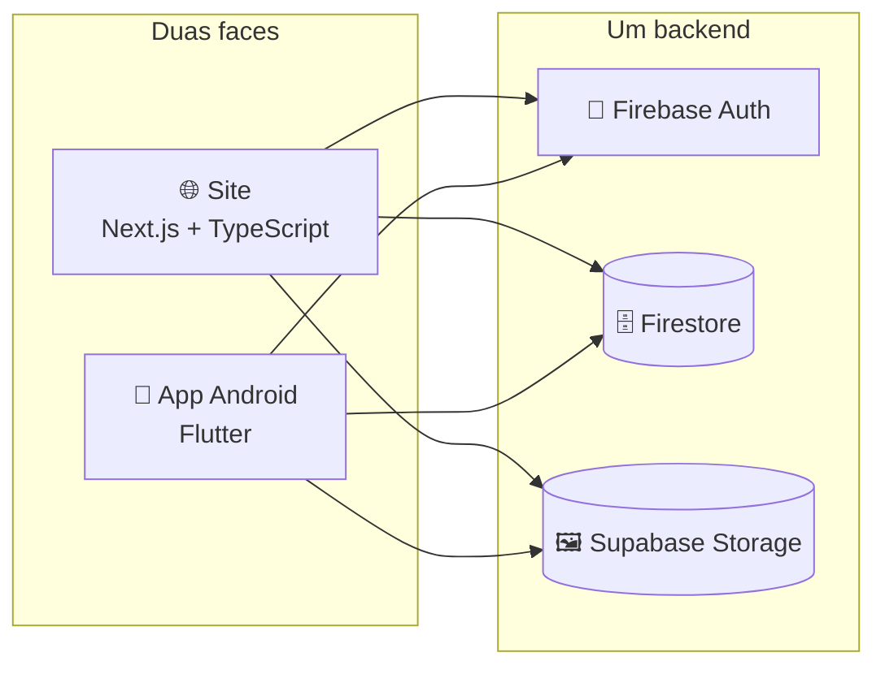

  

  
  
  
  

O **EcoMapBrasil** mostra num lugar só **onde** o desmatamento acontece nos seis biomas
brasileiros, **quais espécies** estão ameaçadas e o que dá para fazer a respeito. Mapa
com os alertas do DETER-B/INPE, gráficos, catálogo de fauna e avaliações da comunidade.

É o Projeto Interdisciplinar de um grupo de cinco do curso de **Desenvolvimento de
Software Multiplataforma** da FATEC, e cresce um semestre por vez, cada um com a
tecnologia da disciplina daquele semestre.

## 🗂️ Os repositórios

| Repositório | O que é | Stack | Estado |
|---|---|---|---|
| [**flutter**](https://github.com/ecomap-devs/flutter) | O app Android | Flutter · Dart | ✅ Em desenvolvimento, com CI e APK a cada PR |
| **web** | O site, no endereço principal | Next.js · TypeScript | 🚧 A criar |
| [**.github**](https://github.com/ecomap-devs/.github) | Esta página | Markdown | ✅ |

## 🧭 Como as partes se encaixam

O site e o app falam com o **mesmo** backend: a conta é a mesma, e uma avaliação feita
no celular aparece no site. As regras de acesso do Firestore são uma só, versionadas no
repositório `flutter`.

## 📅 Um semestre por vez

| Semestre | Tecnologia | O que o projeto ganhou |
|---|---|---|
| 1º | HTML puro | A primeira versão do site |
| 2º | C# | O site em MVC, com banco de dados |
| 3º | React | O site com mapa, gráficos, login e avaliações ([JoaoAlane/EcoMapBrasil](https://github.com/JoaoAlane/EcoMapBrasil)) |
| 4º | Flutter + Next.js | O app Android, e o site portado para Next.js com TypeScript |

## 👥 Equipe

**Vinicius** · **Bruno** · **Cesar** · **João Flávio** · **João Gabriel**

  🌐 <a href="https://ecomapbrasil-17756.web.app"><b>ecomapbrasil-17756.web.app</b></a>

